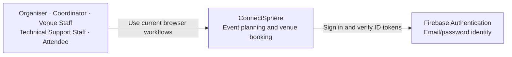
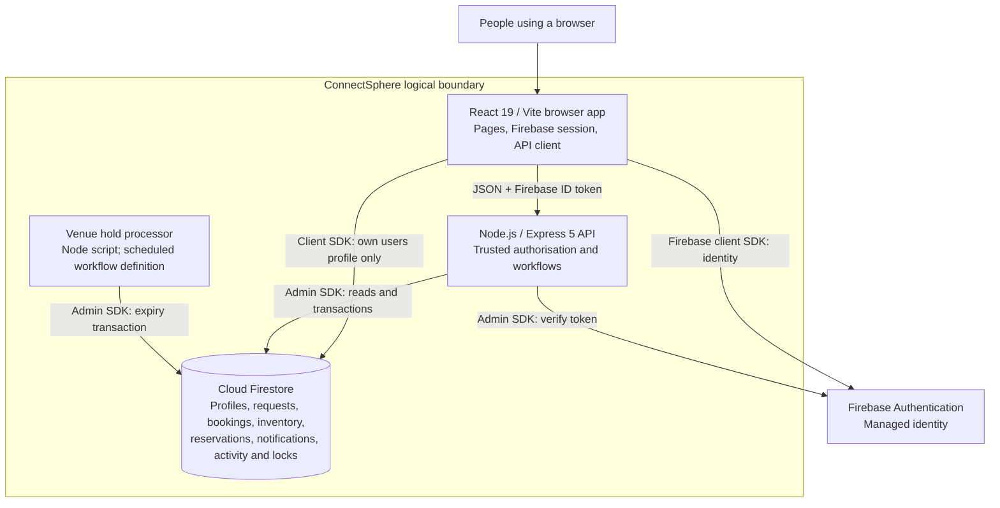
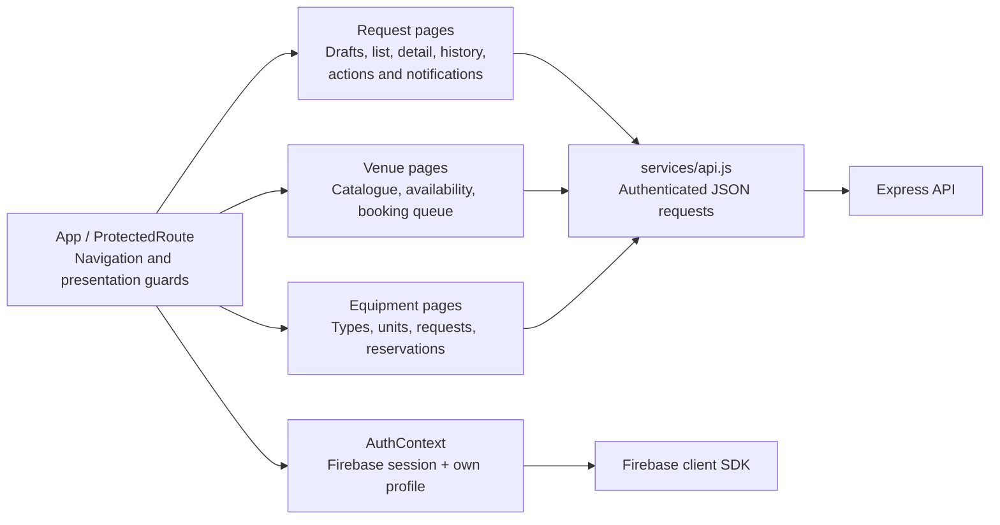
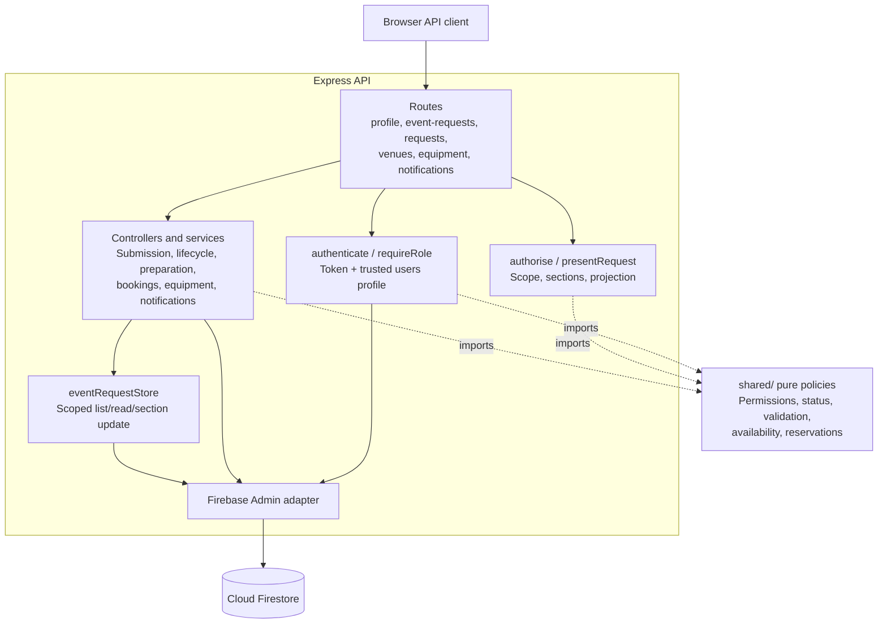

# C4 model

Reviewed against source revision `34bd89a`, 27 October 2026. These logical C4 views show implemented components and configured interactions, not a deployment inventory or a claim that backlog stories are Done. See the [architecture index](README.md) for related documents.

## Level 1 — System context

The current [permission constants](../../shared/permissions.js) and [browser routes](../../frontend/src/App.jsx) recognise five roles. One user can have multiple current roles, with backend permissions evaluated per role before combining access. Later required roles and workflow changes are recorded in [effective requirements](../requirements/effective-requirements.md); they are not drawn as current actors.

## Level 2 — Containers

The [scheduled GitHub Actions workflow](../../.github/workflows/venue-hold-expiry.yml) invokes the [processor](../../backend/scripts/process-venue-holds.js) hourly in repository configuration. Operational execution depends on configured credentials and successful runs; no deployment is inferred. [Firestore rules](../../firestore.rules) allow the browser to access its own profile under limits and deny browser access to event requests; unmatched collections are denied. Admin SDK access bypasses these rules, so the API enforces domain access. Hosting and notification channels beyond the implemented in-app store are unspecified.

## Level 3 — Browser components

The [router](../../frontend/src/App.jsx) exposes role-guarded pages. [AuthContext](../../frontend/src/context/AuthContext.jsx) loads the user's own profile. [Authenticated API calls](../../frontend/src/services/api.js) send a bearer token. Browser role guards are presentation only; request projection and action checks happen in the backend. Notification pages read from the API, not Firestore directly.

## Level 3 — API components

[Express mounts](../../backend/src/app.js) compose route factories. [Authentication](../../backend/src/middleware/authenticate.js) loads trusted profile roles, and [authorisation](../../backend/src/middleware/authorise.js) uses [shared permissions](../../shared/permissions.js) for `/api/requests`. Other action routes enforce shared domain policies in services. The [store](../../backend/src/services/eventRequestStore.js) handles scoped request reads/section writes; draft, transition, booking, equipment and notification services use a Firestore-shaped database directly. There is no separate shared-policy service or universal repository layer.

## Current lifecycle boundary

The [status policy](../../shared/statusTransitions.js) includes Confirmed → Preparation through `start_preparation`; [preparation access](../../shared/preparation.js) permits staff edits only in Preparation. The API supplies a safety decision to that transition, but its [default verifier](../../backend/src/app.js) returns false until the persisted safety review integration exists. The current Confirm action still lacks that safety checkpoint. Submission still [assigns a Coordinator automatically](../../backend/src/services/eventRequestService.js). These limits and other required capabilities are tracked in [effective requirements](../requirements/effective-requirements.md) and [project context](../../project_context.md).
