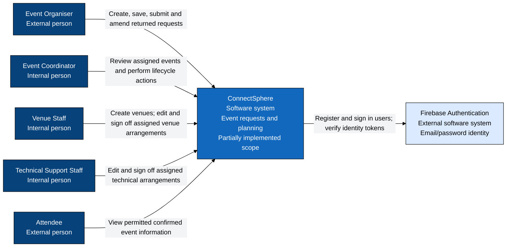
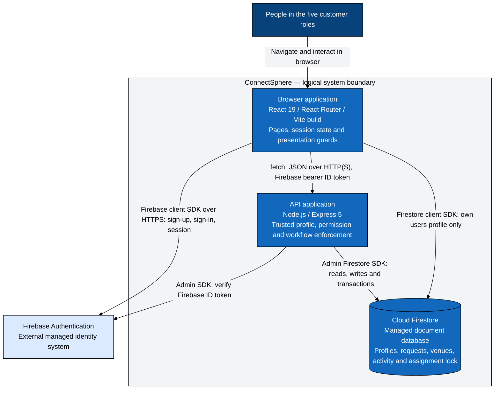
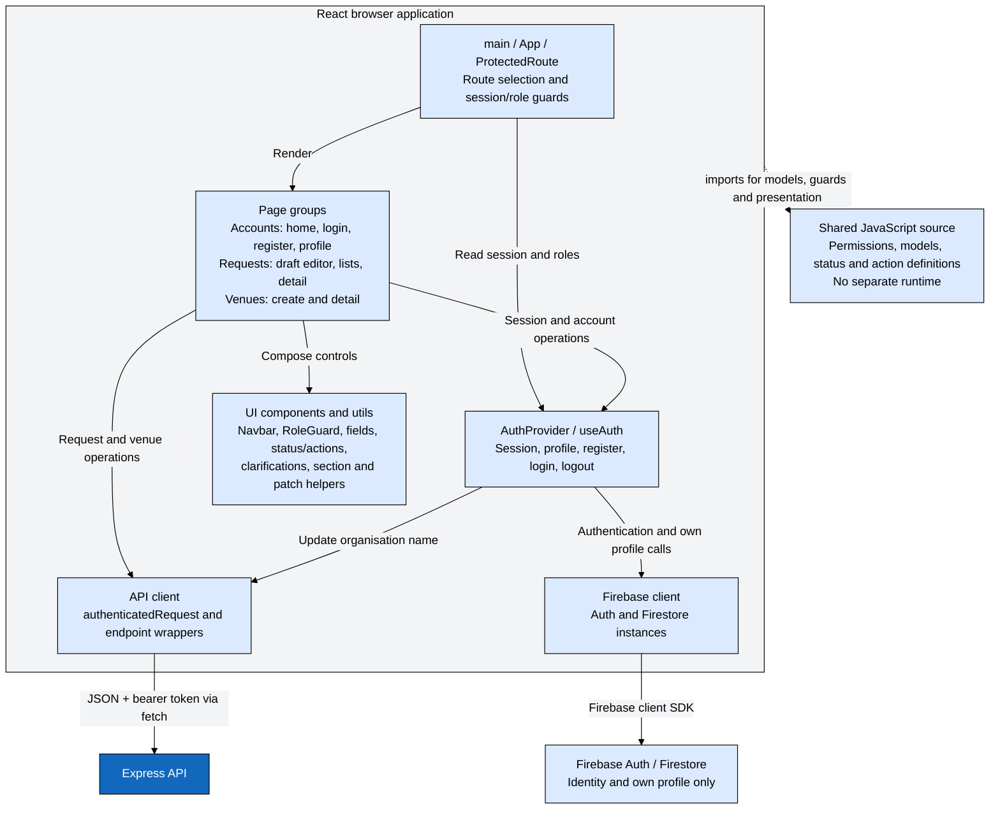
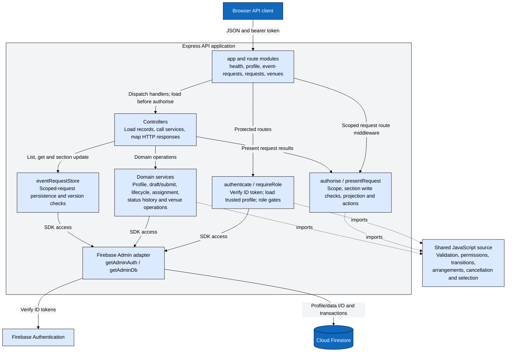
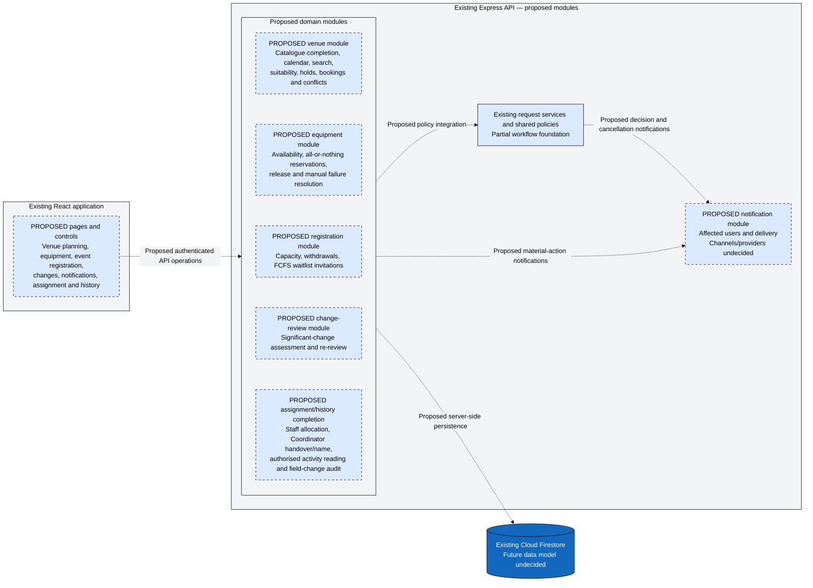

# C4 model

Source snapshot: **`2d02a855192f016c6a88a873033388afa4c369e0`**, reviewed **4 October 2026**. [Navigation, legend and requirements coverage](README.md). C4 Levels 1–3 describe logical architecture using Mermaid flowcharts. Current components below are implemented unless a label explicitly says partial or proposed; that does not imply every supported business workflow is complete.

The palette is fixed in each diagram: light grey backgrounds, black boundaries and arrows, dark blue people, blue systems/containers, and light blue components and other dependencies. Text is white on dark blue/blue and black on light blue/grey. Proposed components retain dashed borders and explicit labels.

## Level 1 — System context

The five roles can overlap on one account. External Organisers and Attendees self-register; staff are provisioned through system scripts. Current responsibilities above follow [routing](../../frontend/src/App.jsx), [permissions](../../shared/permissions.js), [lifecycle policies](../../shared/statusTransitions.js), [sign-off policies](../../shared/arrangements.js), [venue routes](../../backend/src/routes/venueRoutes.js) and [seed provisioning](../../backend/scripts/seed.js). Authentication integration is in [AuthContext](../../frontend/src/context/AuthContext.jsx) and [backend authentication](../../backend/src/middleware/authenticate.js).

Future responsibilities include Coordinator venue search/booking and reassignment; Venue Staff calendar and booking decisions; Technical Support Staff availability/reservations; Attendee registration/waitlists; Organiser formal change requests; notifications and history for authorised users. These are requirements or proposed extensions, not current end-to-end capabilities. Minimal sign-off currently relies on pre-existing staff assignments.

## Level 2 — Containers

The Firestore box is part of ConnectSphere's logical data boundary, hosted by Firebase; this is not a claim that it runs alongside Express. Hosting, TLS termination and notification providers are unspecified. Local API defaults use HTTP; the diagram's HTTP(S) label does not assert a production HTTPS deployment. Firebase Storage is not an implemented container merely because its configuration key exists.

Relationship evidence: [browser Firebase initialisation](../../frontend/src/services/firebase.js), [AuthContext profile access](../../frontend/src/context/AuthContext.jsx), [API client](../../frontend/src/services/api.js), [Express mounts](../../backend/src/app.js), [Admin SDK initialisation](../../backend/src/config/firebaseAdmin.js), [authentication](../../backend/src/middleware/authenticate.js), [request persistence](../../backend/src/services/eventRequestStore.js), [draft/submission service](../../backend/src/services/eventRequestService.js), [venue persistence](../../backend/src/services/venueService.js). [Firestore rules](../../firestore.rules) deny browser access to event requests including activity; unmatched collections such as venues and system locks are denied by default. Admin access bypasses those rules, making backend enforcement essential.

Shared JavaScript is deliberately absent as a container. It is a source dependency of the browser and API components below.

## Level 3 — Frontend components

| Component/relationship          | Source evidence                                                                                                                                                                                                                                    |
| ------------------------------- | -------------------------------------------------------------------------------------------------------------------------------------------------------------------------------------------------------------------------------------------------- |
| Bootstrap, router and guards    | [main](../../frontend/src/main.jsx), [App](../../frontend/src/App.jsx), [ProtectedRoute](../../frontend/src/components/ProtectedRoute.jsx), [access utility](../../frontend/src/utils/access.js)                                                       |
| Authentication context and hook | [AuthContext](../../frontend/src/context/AuthContext.jsx), [useAuth](../../frontend/src/hooks/useAuth.js); guards wait for initial profile loading, while backend checks remain authoritative                                                        |
| Account pages                   | [Home](../../frontend/src/pages/HomePage.jsx), [Login](../../frontend/src/pages/LoginPage.jsx), [Register](../../frontend/src/pages/RegisterPage.jsx), [Profile](../../frontend/src/pages/ProfilePage.jsx)                                             |
| Request pages and calls         | [Editor](../../frontend/src/pages/CreateEventRequestPage.jsx), [Drafts](../../frontend/src/pages/DraftRequestsPage.jsx), [Requests](../../frontend/src/pages/RequestsPage.jsx), [Detail](../../frontend/src/pages/RequestDetailPage.jsx)               |
| Venue pages and calls           | [Create](../../frontend/src/pages/CreateVenuePage.jsx), [Detail](../../frontend/src/pages/VenueDetailPage.jsx)                                                                                                                                       |
| UI and presentation             | [Components](../../frontend/src/components/), [requestSections](../../frontend/src/utils/requestSections.js), [requestPatch](../../frontend/src/utils/requestPatch.js), [statusActions](../../frontend/src/utils/statusActions.js)                     |
| API and Firebase adapters       | [api.js](../../frontend/src/services/api.js), [firebase.js](../../frontend/src/services/firebase.js)                                                                                                                                                 |
| Shared imports                  | [permissions](../../shared/permissions.js), [userProfile](../../shared/userProfile.js), [eventRequest](../../shared/eventRequest.js), [venue](../../shared/venue.js), [status](../../shared/status.js), [requestActions](../../shared/requestActions.js) |

The API supplies projected data, `editableSections` and `availableActions` for request details. Presentation guards do not grant access. A missing or failed initial profile load yields a null profile; it is not evidence of a valid role. Account registration rollback attempts to delete the just-created Auth user if profile creation fails; this is not a cross-service atomic transaction.

## Level 3 — Backend components

This component view shows dependencies, not exact middleware execution order. On `/api/requests/:id`, authentication precedes `loadOne`, authorisation, then response/update. Other paths enforce domain-specific checks in services. Health is unauthenticated.

| Component/relationship                 | Source evidence                                                                                                                                                                                                                                                                                                                                                                                                                            |
| -------------------------------------- | ------------------------------------------------------------------------------------------------------------------------------------------------------------------------------------------------------------------------------------------------------------------------------------------------------------------------------------------------------------------------------------------------------------------------------------------ |
| Bootstrap and route composition        | [server](../../backend/src/server.js), [app](../../backend/src/app.js), [route modules](../../backend/src/routes/)                                                                                                                                                                                                                                                                                                                            |
| Trusted identity and role gates        | [authenticate](../../backend/src/middleware/authenticate.js), [requireRole](../../backend/src/middleware/requireRole.js)                                                                                                                                                                                                                                                                                                                     |
| Scoped checks and presentation         | [authorise](../../backend/src/middleware/authorise.js), [shared permissions](../../shared/permissions.js), [requestActions](../../shared/requestActions.js)                                                                                                                                                                                                                                                                                   |
| Handler orchestration                  | [requestController](../../backend/src/controllers/requestController.js), [eventRequestController](../../backend/src/controllers/eventRequestController.js), [profileController](../../backend/src/controllers/profileController.js), [venueController](../../backend/src/controllers/venueController.js), [healthController](../../backend/src/controllers/healthController.js)                                                                 |
| Domain services and direct persistence | [eventRequestService](../../backend/src/services/eventRequestService.js), [statusTransitionService](../../backend/src/services/statusTransitionService.js), [coordinatorAssignmentService](../../backend/src/services/coordinatorAssignmentService.js), [statusHistory](../../backend/src/services/statusHistory.js), [profileService](../../backend/src/services/profileService.js), [venueService](../../backend/src/services/venueService.js) |
| Store and Firebase adapter             | [eventRequestStore](../../backend/src/services/eventRequestStore.js), [firebaseAdmin](../../backend/src/config/firebaseAdmin.js)                                                                                                                                                                                                                                                                                                             |
| Domain policy dependencies             | [shared modules](../../shared/), detailed in the [code dependency view](codebase-architecture.md#code-dependencies)                                                                                                                                                                                                                                                                                                                          |

There is no single repository layer for all data operations: the scoped request controller uses a store contract, while draft/lifecycle/venue services call a Firestore-shaped database directly. Shared policies contain no database or network I/O.

## Proposed extension view

All dashed modules and relationships below are **engineering proposals** to satisfy the linked requirements. They extend the existing React application and Express API; no new service, hosting platform, queue, provider or collection schema has been selected here.

| Proposed extension              | Requirement and design boundary                                                                                                                                                                                                                                                                                                                                                                                                                                        |
| ------------------------------- | ---------------------------------------------------------------------------------------------------------------------------------------------------------------------------------------------------------------------------------------------------------------------------------------------------------------------------------------------------------------------------------------------------------------------------------------------------------------------- |
| Venue planning (areas 8–14)    | [ER areas 8–14](../requirements/effective-requirements.md#8-venue-catalogue). Extend current venue creation/detail with Coordinator catalogue access and planning. Holds/bookings must enforce capacity and time conflicts; **engineering recommendation:** perform conflict checks and commitment atomically on the server. Exact/partial matches and missing-facility warnings remain decisions.                                                               |
| Equipment (areas 15–17)        | [ER areas 15–17](../requirements/effective-requirements.md#15-equipment-request-management). Choose inventory modelling before implementing availability and atomic all-or-nothing reservation. Minimal technical approval currently consumes no stock. Automatic substitutes are not required.                                                                                                                                                                        |
| Registration (area 18)          | [ER area 18](../requirements/effective-requirements.md#18-attendee-registration). Enforce event/venue capacity; invite the next waitlisted person to apply, never automatically register them. Fields, withdrawal rules and invitation acceptance window are undecided. Organiser settings after submission remain deferred.                                                                                                                                            |
| Changes (areas 7, 19)           | [ER area 19](../requirements/effective-requirements.md#19-event-change-requests). Distinguish routine edits from significant date/time, duration, attendance, venue/layout and equipment changes. Re-review affected arrangements without automatically releasing existing reservations on postponement. Final transitions require recorded policy decisions.                                                                                                           |
| Assignment/history (areas 5–7) | [ER assignment](../requirements/effective-requirements.md#5-coordinator-assignment), [audit requirements](../requirements/effective-requirements.md#audit-and-security-enforcement), SPM-26/28/46/48/65. Reuse assignment policy/transaction mechanisms; handover follows offline agreement and assigned-Coordinator scope. Complete staff allocation and authorised history reading. Exact audit readership and new persistence shapes are not decided by this diagram. |
| Notifications (area 20)         | [ER area 20](../requirements/effective-requirements.md#20-notification-system). Integrate decision, change, cancellation, availability-failure and waitlist events. Channel/provider, delivery preferences, acknowledgements and infrastructure remain unspecified. A status or message visible when a page is opened is not a delivered notification.                                                                                                                  |

Areas 1–3 retain their existing foundation, with organisation membership gaps tracked in the [coverage table](README.md#requirements-to-implementation). Areas 4–7 extend existing review, lifecycle and permission components. Cancellation will also need coordinated reservation release and attendee notification once those domains exist. This view is not a commitment to specific endpoint names or a third event-request route set.
