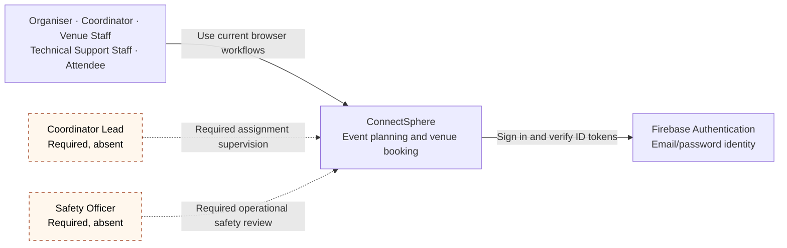
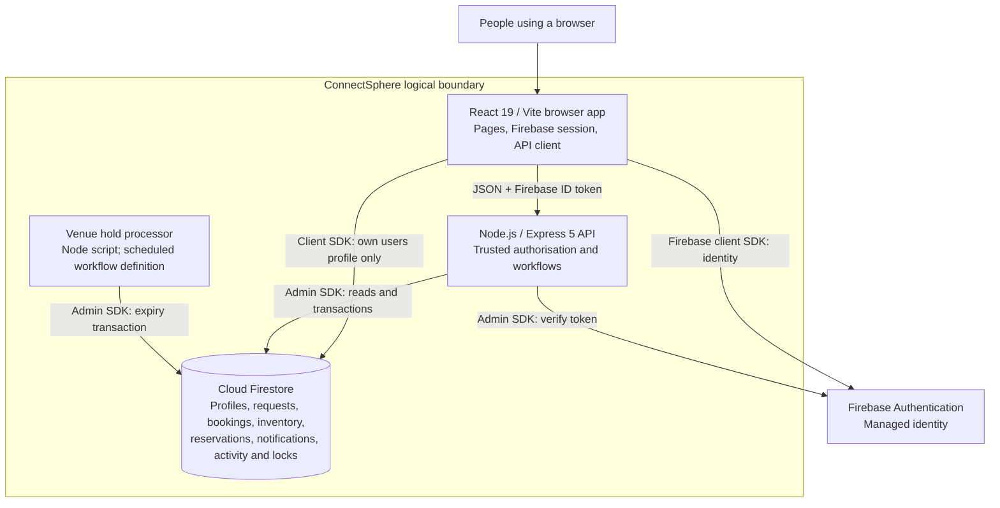
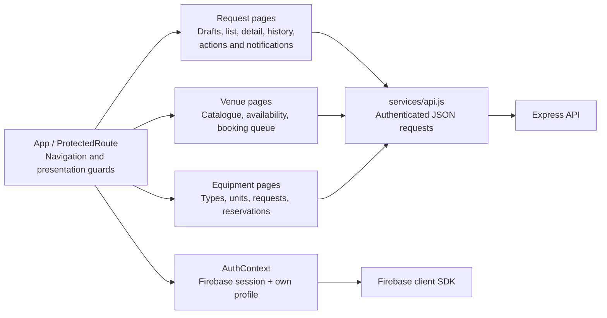
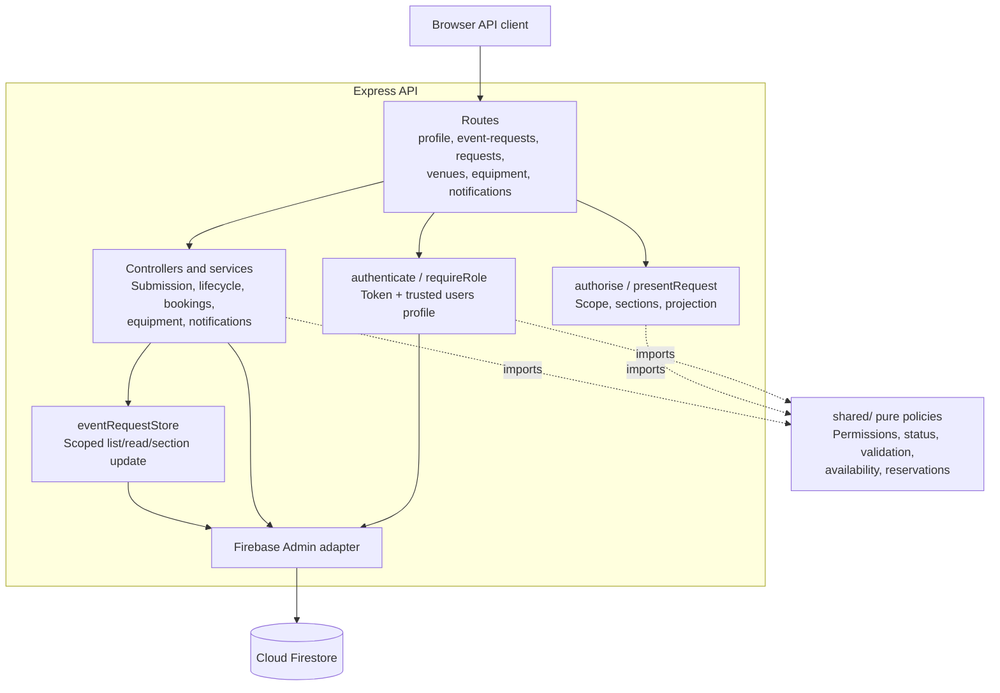
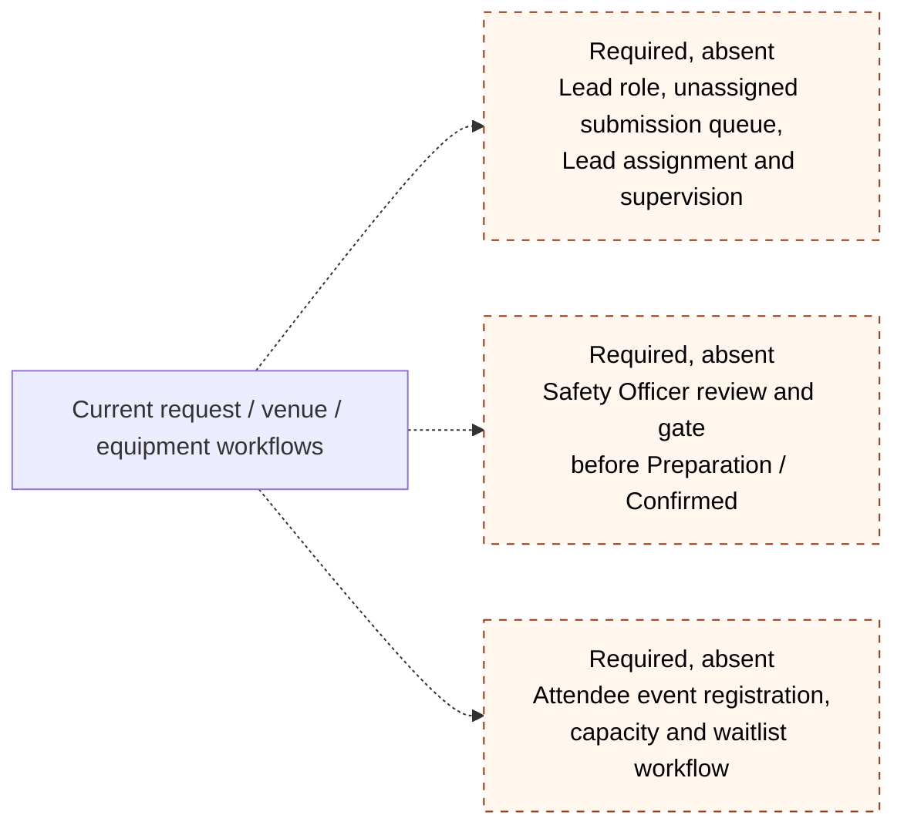

# C4 model

Observed source revision `b8eeecd`, 21 October 2026. These are logical C4 views. “Required, absent” follows [effective requirements](../requirements/effective-requirements.md), not a claim that a proposed implementation has been approved. See the [architecture index](README.md) for documentation findings.

## Level 1 — System context

The current [permission constants](../../shared/permissions.js) and [browser routes](../../frontend/src/App.jsx) recognise five roles. The later Week 7 requirement adds the two internal roles and changes new submissions to a Lead-managed unassigned queue; current [submission](../../backend/src/services/eventRequestService.js) still assigns a Coordinator automatically. The safety review and post-safety Preparation gate are likewise absent. One user can have multiple current roles, with backend permissions evaluated per role before combining access.

## Level 2 — Containers

The [scheduled GitHub Actions workflow](../../.github/workflows/venue-hold-expiry.yml) invokes the [processor](../../backend/scripts/process-venue-holds.js) hourly in repository configuration. Operational execution depends on configured credentials and successful runs; no deployment is inferred. [Firestore rules](../../firestore.rules) allow the browser to access its own profile under limits and deny browser access to event requests; unmatched collections are denied. Admin SDK access bypasses these rules, so the API enforces domain access. Hosting and notification channels beyond the implemented in-app store are unspecified.

## Level 3 — Browser components

The [router](../../frontend/src/App.jsx) exposes role-guarded pages. [AuthContext](../../frontend/src/context/AuthContext.jsx) loads the user's own profile. [Authenticated API calls](../../frontend/src/services/api.js) send a bearer token. Browser role guards are presentation only; request projection and action checks happen in the backend. Notification pages read from the API, not Firestore directly.

## Level 3 — API components

[Express mounts](../../backend/src/app.js) compose route factories. [Authentication](../../backend/src/middleware/authenticate.js) loads trusted profile roles, and [authorisation](../../backend/src/middleware/authorise.js) uses [shared permissions](../../shared/permissions.js) for `/api/requests`. Other action routes enforce shared domain policies in services. The [store](../../backend/src/services/eventRequestStore.js) handles scoped request reads/section writes; draft, transition, booking, equipment and notification services use a Firestore-shaped database directly. There is no separate shared-policy service or universal repository layer.

## Required capability gaps

These are requirements, not extra deployed containers. Current [statuses](../../shared/status.js) contain no safety state, and [preparation access](../../shared/preparation.js) still uses the temporary Planning/Confirmed rule. Formal attendee registration is absent; account registration is a different flow. [Significant-change handling](../../shared/significantChanges.js), [field history](../../shared/changeHistory.js), in-app [notifications](../../backend/src/services/notificationService.js), venue bookings and equipment reservations have current code paths and should not be shown as wholly proposed. Exact completion is tracked in the Product Backlog and evidence records.
