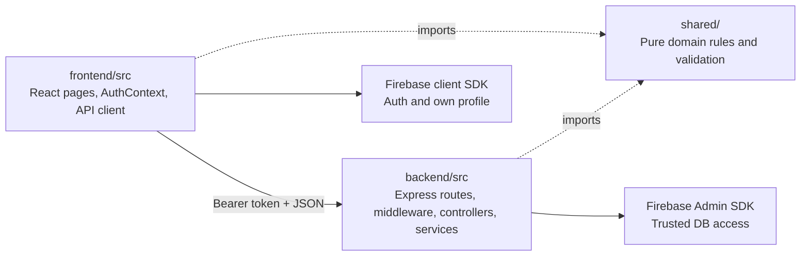
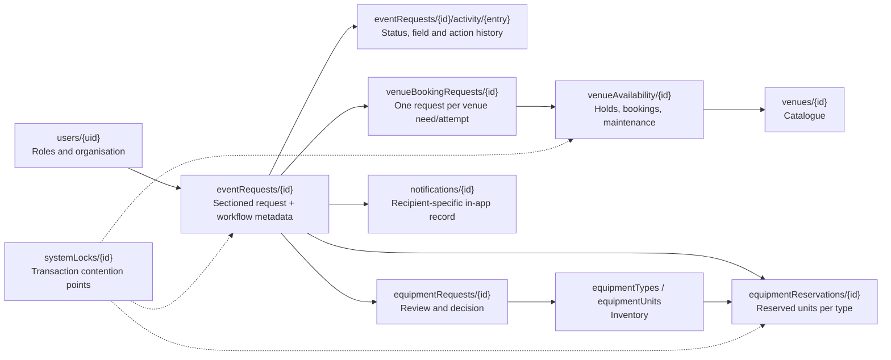

# Codebase architecture

Observed source revision `b8eeecd`, 21 October 2026. This describes current code paths; [effective requirements](../requirements/effective-requirements.md) and the Product Backlog govern required scope and story status. See the [C4 views](c4-model.md) and [documentation findings](README.md#documentation-to-update).

## Source dependencies and trust boundary

[AuthContext](../../frontend/src/context/AuthContext.jsx) signs in with Firebase and reads the signed-in user's `users/{uid}` profile. [Registration](../../frontend/src/pages/RegisterPage.jsx) creates only Organiser/Attendee profiles. Each protected API call sends an ID token through [authenticatedRequest](../../frontend/src/services/api.js). [authenticate](../../backend/src/middleware/authenticate.js) verifies it and loads roles and organisation fields from the server-side profile; request bodies do not supply trusted ownership or roles. A user's role union is implemented in [shared permissions](../../shared/permissions.js), with scope and status checked per role before combining access.

[Firestore rules](../../firestore.rules) limit browser access to the user's own profile and deny `eventRequests/**`; other unmatched collections are denied. Product data flows through Express, whose Admin SDK bypasses browser rules. UI guards therefore do not establish authorisation. Non-owner request responses are projected with `projectRequest`, and scope refusals are applied by [authorise](../../backend/src/middleware/authorise.js).

## API boundaries

All paths below are mounted by [createApp](../../backend/src/app.js). `GET /api/health` is public; product routes require authentication.

| Prefix | Main current operations | Access and implementation |
| --- | --- | --- |
| `/api/profile` | Read own profile; Organiser edits organisation name. | [Profile routes](../../backend/src/routes/profileRoutes.js), [profile service](../../backend/src/services/profileService.js). |
| `/api/event-requests` | Create, load, save and submit owned drafts; transition and Coordinator reassignment actions; venue suitability. | [Routes](../../backend/src/routes/eventRequestRoutes.js), [draft/submission service](../../backend/src/services/eventRequestService.js), [transition service](../../backend/src/services/statusTransitionService.js). |
| `/api/requests` | Scoped list/detail/section edit/history; venue bookings and equipment requests, checks and decisions. | [Routes](../../backend/src/routes/requestRoutes.js), [authorisation](../../backend/src/middleware/authorise.js), [venue booking](../../backend/src/services/venueBookingService.js), [equipment request](../../backend/src/services/equipmentRequestService.js). |
| `/api/venues` | Catalogue create/list/detail/update, maintenance blocks, availability, assigned booking queue. | [Routes](../../backend/src/routes/venueRoutes.js), [venue service](../../backend/src/services/venueService.js). |
| `/api/equipment` | Type/unit inventory, period availability, assigned request queue and scoped reservations. | [Routes](../../backend/src/routes/equipmentRoutes.js), [equipment service](../../backend/src/services/equipmentService.js), [reservation service](../../backend/src/services/equipmentReservationService.js). |
| `/api/notifications` | List and mark only the signed-in recipient's in-app notifications as read. | [Routes](../../backend/src/routes/notificationRoutes.js), [notification service](../../backend/src/services/notificationService.js). |

The status split is deliberate: `/api/event-requests` creates/edits Drafts; `/api/requests` handles post-submission reads and section edits. Lifecycle actions use `/api/event-requests/:id/transitions`, with a named action rather than a client-selected status. Request section PATCH cannot write status or protected top-level workflow metadata. The relevant policies are [shared/statusTransitions.js](../../shared/statusTransitions.js), [shared/permissions.js](../../shared/permissions.js), and domain-specific shared modules. After authorisation, significant fields and preparation sections have validation middleware; ordinary post-submission section values still lack general field validation, as recorded in [AGENTS.md](../../AGENTS.md).

## Persistence model

Arrows show logical relationships, not Firestore subcollections except `activity`. Request sections are `core`, `venue`, `equipment`, `registration`, `internal`, `venuePreparation` and `equipmentPreparation`; owner, status, assignments and workflow summaries are top-level metadata. The source of field shape is [shared/eventRequest.js](../../shared/eventRequest.js). `venueBookingRequests` can hold several venue needs for one event; each attempt has its own venue/time, assigned staff decision and hold in `venueAvailability`. Replacement retains its need identity. See [venue booking service](../../backend/src/services/venueBookingService.js) and [venue policy](../../shared/venueBooking.js).

Inventory is recorded as types and individual units. [Equipment request service](../../backend/src/services/equipmentRequestService.js) approves/rejects and reserves through an action; [reservation service](../../backend/src/services/equipmentReservationService.js) supplies overlap exclusion and release. Reservations belong to an event, not a venue booking. [Notification service](../../backend/src/services/notificationService.js) stores one document per recipient and serves only that recipient. These collections are Admin-only under the current browser rules.

## Transaction and time boundaries

- **Submit and assignment.** [Submission](../../backend/src/services/eventRequestService.js) validates the persisted request, sets Submitted, uses [coordinator assignment](../../backend/src/services/coordinatorAssignmentService.js) and `systemLocks/coordinatorAssignment`, and writes activity in one Firestore transaction. This is the current automatic path; Week 7 requires a Lead-managed unassigned queue instead. Saving a draft and submitting it are separate HTTP operations.
- **Section edits.** [eventRequestStore](../../backend/src/services/eventRequestStore.js) uses a read-version precondition and writes field-change activity with the edit. [Significant-change policy](../../shared/significantChanges.js) may clear sign-offs and move Confirmed back to Planning in that transaction. The client's earlier page-load version is not itself sent as a concurrency token.
- **Venue commitments.** [Venue booking](../../backend/src/services/venueBookingService.js) creates a per-request tentative hold; approval changes that hold to a confirmed booking. [Venue conflicts](../../shared/venueConflicts.js) include venue-specific setup/turnaround. `systemLocks/venueBooking-{venueId}` serialises competing commitments. [Hold expiry](../../backend/src/services/venueHoldExpiryService.js) processes warnings/expiry through the configured [scheduled workflow](../../.github/workflows/venue-hold-expiry.yml); read-time checks also ignore expired holds without waiting for the job.
- **Equipment commitments.** [Availability](../../backend/src/services/equipmentAvailabilityService.js), approval and reserve use [loadReservedUnitIds](../../backend/src/services/equipmentReservationService.js). Reserving uses per-type `systemLocks/equipmentReservation-{typeId}` documents. Whole-event rejection/cancellation releases active equipment reservations and venue commitments through the status transaction; changing one venue arrangement does not release unrelated reservations.

## Required gaps and verification limits

The current [roles](../../shared/permissions.js) contain five values, while [effective requirements §2.1](../requirements/effective-requirements.md#21-roles-and-accounts) require the added Coordinator Lead and Safety Officer. Current submission still auto-assigns a Coordinator. Current [preparation gate](../../shared/preparation.js) allows edits at Planning or Confirmed under its temporary condition, while later requirements put Preparation after safety approval. Attendee event registration and waitlist workflows are absent. This model does not convert an upstream booking/request action into completion of those downstream workflows.

The root [test scripts](../../package.json) run Node, Vitest and Playwright suites. Most API/component/E2E tests use mocks or in-memory Firestore doubles; they establish application behavior, not production database or deployed-rule behavior. Separate emulator suites exist for venue and equipment concurrency. The opt-in live API harness uses a real Firebase project with seeded data; it does not prove that Express itself is deployed. No tests, live Firebase checks, rule deployment, or manual browser check were run for this documentation-only revision.
