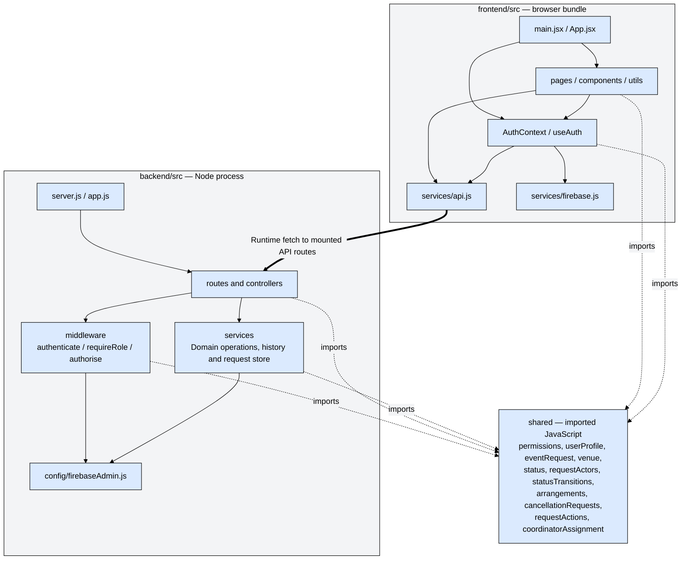
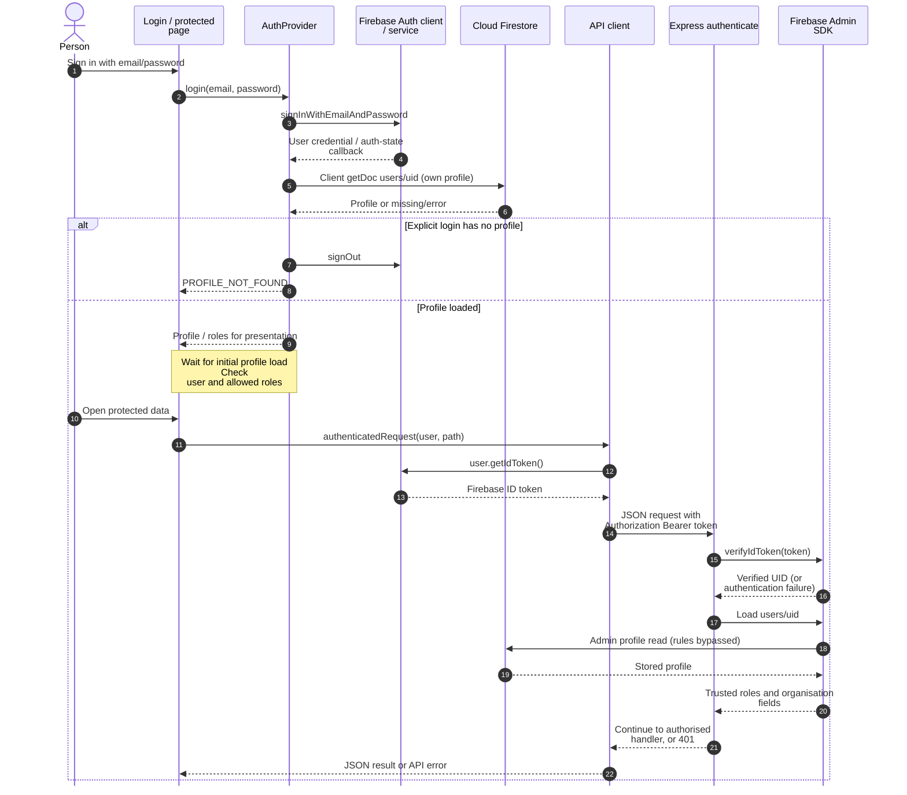
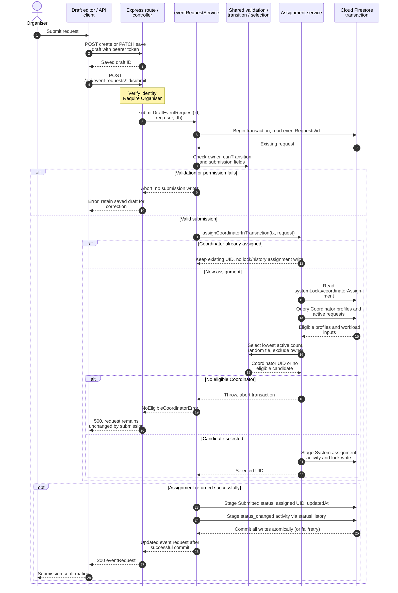

# Codebase architecture

Source snapshot: **`2d02a855192f016c6a88a873033388afa4c369e0`**, reviewed **4 October 2026**. [Architecture guide](README.md) · [C4 views](c4-model.md). This document describes implemented code and explicitly calls out incomplete workflows.

## Code dependencies

Thin arrows denote source dependencies, the thick arrow is the network boundary, and dotted `imports` arrows emphasise shared code. Directory nodes group modules; they do not imply every file imports every target. [Root workspaces](../../package.json) contain [frontend](../../frontend/package.json), [backend](../../backend/package.json) and [shared](../../shared/package.json). The [frontend entry](../../frontend/src/main.jsx), [router](../../frontend/src/App.jsx), [API wrappers](../../frontend/src/services/api.js), [backend composition](../../backend/src/app.js), [controllers](../../backend/src/controllers/), [middleware](../../backend/src/middleware/) and [services](../../backend/src/services/) establish these links. [Shared modules](../../shared/) are bundled/imported into those processes; there is no shared-service HTTP hop.

## Authentication and profile loading

Evidence: [AuthContext](../../frontend/src/context/AuthContext.jsx), [ProtectedRoute](../../frontend/src/components/ProtectedRoute.jsx), [API client](../../frontend/src/services/api.js), [authenticate](../../backend/src/middleware/authenticate.js), [Firebase Admin](../../backend/src/config/firebaseAdmin.js), [session tests](../../tests/spm-1/integration/authProvider.session.test.jsx), [middleware tests](../../tests/spm-1/unit/authenticate.middleware.test.js).

The sequence condenses two profile-loading paths: explicit `login()` and `onAuthStateChanged` both load the own profile, so sign-in can cause two reads. Session restoration uses the callback without a new password sign-in. A callback failure sets the profile to null and finishes loading; explicit login signs out on a missing profile. The backend independently loads trusted roles from Firestore for each authenticated request; it never trusts roles supplied in a request body.

Registration uses Firebase Auth directly, then creates `users/{uid}` through the client SDK. [Registration profile construction](../../shared/userProfile.js) allows Organiser/Attendee and records `roles` plus legacy `role`. [Firestore rules](../../firestore.rules) restrict own-profile access and prevent browser updates to roles, organisation fields and `seedTag`. The browser has no event-request access. Current client profile writes are registration writes; organisation-name editing goes through the validated [profile API service](../../backend/src/services/profileService.js). Names are descriptive and do not grant shared organisation access or assign company IDs.

## API and data boundaries

The [API wrappers](../../frontend/src/services/api.js) match the following [Express mounts](../../backend/src/app.js). All product endpoints require a Firebase bearer token; health is the exception.

| API path                                                                  | Current caller / handler                                                                                                                                | Enforcement and response                                                                                                                                                                                                |
| ------------------------------------------------------------------------- | ------------------------------------------------------------------------------------------------------------------------------------------------------- | ----------------------------------------------------------------------------------------------------------------------------------------------------------------------------------------------------------------------- |
| `GET /api/health`                                                       | Health controller                                                                                                                                       | No authentication.                                                                                                                                                                                                      |
| `GET /api/profile`; `PATCH /api/profile`                              | `getApiProfile` wrapper (not the AuthContext loading path); organisation-name editor → [profile routes](../../backend/src/routes/profileRoutes.js)    | Authenticated own profile; PATCH requires Organiser and validates organisation name.                                                                                                                                    |
| `POST /api/event-requests`; `GET` / `PATCH /api/event-requests/:id` | Draft editor →[draft routes](../../backend/src/routes/eventRequestRoutes.js) → [eventRequestService](../../backend/src/services/eventRequestService.js) | Organiser role; owner-and-Draft check on read/update; normalised draft input; owner/organisation metadata taken from`req.user` on create. Returns `{ eventRequest }`.                                               |
| `POST /api/event-requests/:id/submit`                                   | Draft editor's`submitEventRequest` → same service                                                                                                    | Existing endpoint, not proposed. Owner and transition checks, submission validation, atomic assignment/status/history. Returns`{ eventRequest }` to the owner. Service also supports Returned resubmission.           |
| `GET /api/requests`; `GET` / `PATCH /api/requests/:id`              | Drafts/list/detail pages →[request routes](../../backend/src/routes/requestRoutes.js)                                                                   | Scope-filtered list, projected detail, authorised section patches. Detail/update return`request`, `editableSections`, `availableActions` and role-appropriate summaries.                                          |
| `POST /api/event-requests/:id/transitions`                              | Detail page's`transitionRequest` → [statusTransitionService](../../backend/src/services/statusTransitionService.js)                                   | Client sends`{ action, reason? }`, not a target status. Shared policies decide transition, sign-off or cancellation action. Submit/resubmit reuse the submission service. Response passes through `presentRequest`. |
| `POST /api/venues`; `GET /api/venues/:id`                             | Venue create/detail pages →[venue routes](../../backend/src/routes/venueRoutes.js)                                                                      | Venue Staff only, including read.[Venue service](../../backend/src/services/venueService.js) validates create input and persists creator/time metadata. No list/update routes.                                           |

The team routes draft editing to `/event-requests/:id/edit`, and non-draft reading/editing to `/requests/:id`. Both lists use `/api/requests`; this means the scoped list can return owned drafts as well as non-drafts. The scoped API's permission matrix also permits owned Draft section edits; the route split is the chosen UI/validation path, not an absolute server prohibition on draft PATCH through `/api/requests`.

[Permissions](../../shared/permissions.js) evaluate scope, status and sections **per role, then union the results**. Combining the any-role `inScope()` and `stateGateOpen()` functions to decide section edits would be incorrect. [Authorisation middleware](../../backend/src/middleware/authorise.js) uses `canEdit`, `forbiddenFields` and `projectRequest`; non-section keys such as `status` or assignment metadata cannot be changed by section PATCH. Non-owner responses use projection so hidden sections are absent from JSON. Owner-only draft endpoints return the full owner record instead.

Coordinators see assigned events; a Coordinator-only list is narrowed by an `assignedCoordinatorUid` query before policy filtering. Other role combinations currently load all requests and then filter/project on the server. Out-of-scope detail/update/transition access yields 404 for users holding the Coordinator role and 403 for other roles, after union scope evaluation. A second role can legitimately give record access but cannot confer an unassigned Coordinator's lifecycle powers. Attendees currently see only core information for Confirmed events with registration enabled. Organisation viewing compares IDs, never names.

| Firestore path                            | Current use and access                                                                                                                                                                                                                                                                                                                    |
| ----------------------------------------- | ----------------------------------------------------------------------------------------------------------------------------------------------------------------------------------------------------------------------------------------------------------------------------------------------------------------------------------------- |
| `users/{uid}`                           | Auth profile, roles and organisation data. Own browser reads/limited writes under rules; Admin reads for authentication and assignment.[AuthContext](../../frontend/src/context/AuthContext.jsx), [authenticate](../../backend/src/middleware/authenticate.js).                                                                             |
| `eventRequests/{id}`                    | Sections`core`, `venue`, `equipment`, `registration`, `internal`; top-level owner/status/assignment and workflow metadata. [Input model](../../shared/eventRequest.js), [store](../../backend/src/services/eventRequestStore.js), [transition service](../../backend/src/services/statusTransitionService.js). Express/Admin only. |
| `eventRequests/{id}/activity/{entryId}` | Coordinator assignment, status changes, arrangement and cancellation decisions.[Assignment service](../../backend/src/services/coordinatorAssignmentService.js), [statusHistory](../../backend/src/services/statusHistory.js), [transition service](../../backend/src/services/statusTransitionService.js). No read API/UI exists.           |
| `systemLocks/coordinatorAssignment`     | Serialises new Coordinator assignments in submit transactions.[Assignment service](../../backend/src/services/coordinatorAssignmentService.js). No browser access.                                                                                                                                                                         |
| `venues/{id}`                           | Catalogue records, independent of event`venue` preference sections. [Venue service](../../backend/src/services/venueService.js). Admin-only persistence; unmatched browser paths denied by default.                                                                                                                                      |

No booking, inventory reservation, attendee registration, notification or formal change-request collection is established by the inspected application. Future names and schemas are unspecified. The current API's Admin SDK bypasses rules; rules alone do not enforce the API's business permissions.

## Submission with Coordinator assignment

Evidence: [editor save-before-submit](../../frontend/src/pages/CreateEventRequestPage.jsx), [API calls](../../frontend/src/services/api.js), [route](../../backend/src/routes/eventRequestRoutes.js), [controller/error mapping](../../backend/src/controllers/eventRequestController.js), [submission service](../../backend/src/services/eventRequestService.js), [assignment service](../../backend/src/services/coordinatorAssignmentService.js), [selection policy](../../shared/coordinatorAssignment.js), [status history](../../backend/src/services/statusHistory.js). Supporting tests: [submission](../../tests/spm-3/integration/eventRequestService.test.js), [assignment](../../backend/src/services/coordinatorAssignmentService.test.js), [selection](../../shared/coordinatorAssignment.test.js), [return/resubmit API](../../tests/spm-25/integration/returnForClarificationApi.test.js).

The editor's save and submit are **two HTTP operations**, not one transaction. The sequence continues only after a successful save; a failed save stops submission. The server-side submit transaction validates persisted data and commits status, assignment and history together. Active workload means Submitted, Under Review, Returned, Planning or Confirmed. The assignment lock is read and written only when selecting a new Coordinator; overlapping assignments contend on this document. Selection rules are implemented but await ratification. In-memory tests do not establish real Firestore transaction behaviour under load.

Returned requests are edited via scoped PATCH on the detail page, then resubmitted through `/transitions` with action `resubmit`. `transitionBySubmission` checks scope/action and delegates to `submitDraftEventRequest`, which rechecks the record inside its transaction. Resubmission keeps the Coordinator, records the status change and retains clarification metadata. Neither submission endpoint sends a notification.

## Concurrency and validation

[Scoped section updates](../../backend/src/services/eventRequestStore.js) carry the Firestore `updateTime` read by the server's `loadOne` into a `lastUpdateTime` write precondition. The field paths use `FieldPath(section, field)`, so a dot in a field name cannot escape a section. A changed/deleted record returns 409 through [requestController](../../backend/src/controllers/requestController.js). This protects the interval between server authorisation and write; the browser does not submit a version from when the user opened the page, so it is not general protection against overwriting edits made during a long editing session.

Authorised section PATCH validates structure and permission, **not field names/values within an allowed section**. Reusing `normaliseEventRequestInput` for patched sections is the recorded recommendation, not implemented scope. Submit/resubmit and Approve use submission validation, but that does not validate every saved post-submission edit. Section edits do not write general field-change history, clear arrangement sign-off or trigger significant-change review.

Draft updates instead read the document, check owner/Draft, then update it without a transaction/version precondition. They do not share the scoped store's concurrency guarantee. Lifecycle actions and new assignments run in transactions against the checked record. These are different concurrency boundaries; the docs do not claim a global transaction across every edit or workflow.

## Lifecycle and workflow limits

[Status constants](../../shared/status.js) and [statusTransitions](../../shared/statusTransitions.js) define Draft → Submitted → Under Review, then return to Returned/resubmit, approve to Planning, or reject. Planning can be confirmed only after mandatory arrangements are approved. Confirmed can be completed after event end or cancelled; Completed, Cancelled and Rejected are terminal. The assigned Coordinator completes manually; no scheduler exists. The recorded 1 October team interpretation maps the status word Approved to Confirmed, while the review action Approve leads to Planning.

[Arrangements](../../shared/arrangements.js) require venue sign-off always, technical sign-off only when equipment or support is requested, and assigned staff decisions only at Planning. [Cancellation policy](../../shared/cancellationRequests.js) allows the owner to request cancellation of Confirmed events and the assigned Coordinator to approve/refuse; direct Coordinator cancellation requires a reason. These use protected top-level `arrangementApprovals` and `cancellationRequest` metadata. [Clarification messages](../../shared/requestActions.js) use `clarificationRequests` metadata. Status, arrangement and cancellation activity entries are written transactionally, but only selected summaries/messages are presented to users.

New requests have no staff assignment workflow, so their mandatory arrangement approvals cannot be reached through normal product actions. [Seed data](../../backend/scripts/seedData.js) supplies assigned staff for demonstrations/tests. No actual venue booking or equipment reservation is created by sign-off. No reservation release or attendee notification occurs on cancellation. No general history reader, Coordinator handover/name display or significant-change review exists. [Venue creation/detail](../../backend/src/routes/venueRoutes.js) is a separate partial catalogue increment restricted to Venue Staff; operating-hours text is not an availability engine. See the [20-area gap table](README.md#requirements-to-implementation) before treating any upstream feature as a completed downstream workflow.

## Production and test boundaries

| Environment/seam                              | Actual dependency and what evidence means                                                                                                                                                                                                                                                                                                                                                                                                                                    |
| --------------------------------------------- | ---------------------------------------------------------------------------------------------------------------------------------------------------------------------------------------------------------------------------------------------------------------------------------------------------------------------------------------------------------------------------------------------------------------------------------------------------------------------------- |
| Production defaults                           | [server](../../backend/src/server.js) uses [createApp defaults](../../backend/src/app.js): real Firebase authentication, `firestoreEventRequestStore`, `getAdminDb` for event/venue services. Browser [Firebase client](../../frontend/src/services/firebase.js) uses configured Firebase services. Describes wiring, not a verified deployment.                                                                                                                            |
| Shared/unit and component tests               | [Shared tests](../../shared/), [story suites](../../tests/), [frontend tests](../../frontend/src/). Pure policies, mock SDKs, Testing Library and fake databases test application behaviour; they do not execute deployed rules.                                                                                                                                                                                                                                                |
| SPM-42/SPM-24 in-memory HTTP API harness      | [requestApiServer](../../tests/shared/helpers/requestApiServer.js) injects token verification/profile loading and [memoryEventRequestStore](../../backend/src/testing/memoryEventRequestStore.js). Real Express HTTP/middleware; not production database integration. Shared [SPM-42 cases](../../tests/spm-42/integration/requestApi.cases.js) and [draft-list cases](../../tests/spm-24/integration/draftListApi.cases.js).                                                    |
| Draft/lifecycle/venue service and route tests | Inject a Firestore-shaped[fake database](../../backend/src/testing/fakeFirestore.js), and authentication where appropriate. Examples: [SPM-3 service tests](../../tests/spm-3/integration/eventRequestService.test.js), [SPM-9 API tests](../../tests/spm-9/integration/statusTransitionsApi.test.js), [SPM-6 route tests](../../tests/spm-6/integration/venueRoutes.test.js). Transaction simulation is not real concurrency verification.                                      |
| Playwright E2E                                | [Playwright config](../../playwright.config.js), [Vite SDK aliases](../../tests/shared/firebase-double/vite.e2e.config.js) and [double server](../../tests/shared/firebase-double/doubleServer.js) run the real browser app and request API against one in-memory database. The [fake request store](../../tests/shared/firebase-double/fakeFirestoreEventRequestStore.js) and memory store follow the production store contract. This is not Firebase or the Firebase emulator. |
| Injection limits                              | `createApp` injects authentication for request and venue route factories, request store, event DB and venue DB. [Profile routes](../../backend/src/routes/profileRoutes.js) import production authentication directly. The E2E double does not pass `getVenueDb`, so venue routes retain the production default there; do not assume all API paths are isolated by the existing double. Current venue suites explicitly inject their own database.                        |
| Opt-in live API harness                       | `LIVE_API_PROJECT=<FIREBASE_PROJECT_ID> npm run test:api:live` selects real Auth sign-ins and Firestore via [startLiveApi](../../tests/shared/helpers/requestApiServer.js). Runs the scoped-request/draft-list cases against a locally started Express app using the real Firebase project, not a deployed Express service. It edits/restores seeded requests; re-seeding is needed after interruption. Not run for this documentation review.                              |
| Security-rule evidence                        | [Static test](../../tests/spm-2/integration/firestoreRules.static.test.js) checks source text only. [Live rules script](../../backend/scripts/check-firestore-rules.js) is a separate signed-in client check. Historical deployment results in project context are not fresh verification. No rules were edited or deployed here.                                                                                                                                              |

[CI](../../.github/workflows/ci.yml) defines lint, existing suites, Vitest coverage, build and Playwright checks. Their existence and prior recorded results are separate from [this documentation review&#39;s checks](README.md#documentation-verification). No new production, emulator or deployment assurance is inferred from rendering diagrams.
